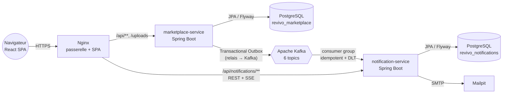

# Revivo — marketplace de seconde main event-driven

     

**Revivo** est une plateforme C2C de vente de vêtements et d'objets d'occasion : un membre publie un article,
un autre l'achète (ou négocie le prix), le paiement reste **sous séquestre** jusqu'à la réception, puis
les deux parties s'évaluent. C'est un projet de portfolio : il montre comment je conçois et livre une application
**Java / Spring / Kafka / React** proche des conditions de production.

> Projet personnel à but démonstratif, inspiré des mécaniques des marketplaces de seconde main.
> Nom, identité visuelle et code sont originaux. Paiements **simulés** : aucune transaction réelle.

---

## Sommaire
- [Fonctionnalités](#fonctionnalités)
- [Architecture](#architecture)
- [Démarrage rapide](#démarrage-rapide)
- [Stack technique](#stack-technique)
- [Structure du dépôt](#structure-du-dépôt)
- [Qualité et tests](#qualité-et-tests)
- [Choix techniques notables](#choix-techniques-notables)
- [Documentation détaillée](#documentation-détaillée)
- [Pistes d'évolution](#pistes-dévolution)

## Fonctionnalités

| Domaine | Fonctionnalités |
|---|---|
| **Comptes** | Inscription / connexion JWT, refresh token avec **rotation et détection de réutilisation**, profil public, bio/ville, **mode vacances**, changement de mot de passe (révoque toutes les sessions) |
| **Catalogue** | Annonces avec 1 à 10 photos (upload contrôlé par *magic numbers*), catégories hiérarchiques, marques, tailles, couleurs, états ; modification, masquage, suppression |
| **Recherche** | Plein texte (titre, description, marque), filtres combinables (catégorie + sous-catégories, marque, taille, état, fourchette de prix), 4 tris, pagination, articles similaires |
| **Social** | Favoris, abonnements entre membres, **fil d'actualité** des membres suivis, compteur de vues |
| **Négociation** | Offres de prix (plancher configurable : 30 % du prix), acceptation / refus, expiration automatique (48 h), offre acceptée valable 24 h au checkout |
| **Achat** | Devis détaillé (prix, **protection acheteur**, livraison), 3 modes de livraison, paiement via un **PSP simulé** avec clé d'idempotence, verrou pessimiste contre la double vente, compensation (remboursement) en cas d'échec |
| **Commandes** | Machine à états `PAID → SHIPPED → DELIVERED → COMPLETED`, annulation avant expédition, **litiges**, validation automatique 48 h après livraison |
| **Porte-monnaie** | Fonds **sous séquestre** puis libérés, journal des mouvements append-only, retrait vers IBAN |
| **Avis** | Évaluation croisée acheteur ↔ vendeur après finalisation, moyenne calculée de façon incrémentale |
| **Messagerie** | Conversations par article, non-lus, accusés de lecture |
| **Notifications** | **Temps réel (SSE)** + e-mails transactionnels, alimentés par **Kafka** : vente, offre, expédition, baisse de prix d'un favori, nouvel abonné, message… |
| **Modération** | Signalements (contrefaçon, arnaque…), retrait d'annonce, suspension de compte, arbitrage des litiges, tableau de bord KPI |

## Architecture



- **marketplace-service** : le cœur transactionnel (monolithe modulaire, un package par *bounded context*).
  Chaque changement d'état métier écrit un **événement dans une table outbox, dans la même transaction**.
  Un relais le publie ensuite sur Kafka, ce qui garantit une livraison *at-least-once* sans 2PC.
- **notification-service** : consommateur Kafka **idempotent** (table `processed_events`). Il garde sa propre
  projection des utilisateurs (*event-carried state transfer*) et pousse les notifications en **Server-Sent Events**
  et par e-mail. Il ne fait **aucun appel synchrone** au marketplace.
- **revivo-events** : module partagé qui définit le **contrat des événements** (records Java sérialisés en JSON polymorphe).

👉 Diagrammes de séquence, machine à états et modèle de données : [docs/architecture.md](docs/architecture.md)

## Démarrage rapide

### Option 1 — tout en Docker (recommandé)

```bash
cd revivo
cp .env.example .env          # facultatif
docker compose up --build
```

| URL | Service |
|---|---|
| http://localhost:3000 | Application web |
| http://localhost:8081/swagger-ui.html | API marketplace (OpenAPI) |
| http://localhost:8082/swagger-ui.html | API notifications |
| http://localhost:8090 | Kafka UI (topics, messages, consumer lag) |
| http://localhost:8025 | Mailpit (e-mails envoyés) |

**Comptes de démonstration** (créés au premier démarrage, mot de passe `Password123!`) :
`alice@revivo.dev` (vendeuse), `bob@revivo.dev`, `chloe@revivo.dev`, `admin@revivo.dev` (modération).

> 💡 Démo en 2 minutes : connectez-vous en **bob** dans une fenêtre et en **alice** dans une fenêtre privée.
> Bob fait une offre sur la veste en jean, Alice l'accepte (sa notification s'affiche **en temps réel**),
> Bob achète, Alice expédie, Bob valide : les fonds passent de « en attente » à « disponible » dans le porte-monnaie d'Alice.

### Option 2 — développement local

Prérequis : JDK 21, Maven 3.9, Node 22, Docker (pour PostgreSQL, Kafka et Mailpit).

```bash
docker compose up -d postgres kafka mailpit kafka-ui

cd backend && mvn install -DskipTests
java -jar marketplace-service/target/marketplace-service.jar      # :8081
java -jar notification-service/target/notification-service.jar   # :8082

cd ../frontend && npm install && npm run dev                        # :5173 (proxy vers les API)
```

## Stack technique

| Couche | Technologies |
|---|---|
| Backend | Java 21 (records, *pattern matching* sur `switch`), Spring Boot 3.5, Spring Web MVC, Spring Data JPA / Hibernate 6, Spring Security 6, Bean Validation, Spring Kafka, Spring Mail |
| Données | PostgreSQL 16, migrations **Flyway**, verrouillage optimiste (`@Version`) et pessimiste (`SELECT … FOR UPDATE`) |
| Messaging | Apache Kafka 3.9 (KRaft, sans ZooKeeper), Transactional Outbox, DLT, back-off exponentiel |
| Sécurité | JWT HS256 (jjwt), BCrypt, refresh tokens hachés SHA-256 à usage unique, autorisation par rôle |
| API | REST, erreurs **RFC 7807** (`ProblemDetail`), documentation **OpenAPI 3** (springdoc) |
| Frontend | React 18, TypeScript (strict), Vite, React Router, **TanStack Query**, Axios (intercepteur de refresh), EventSource (SSE) |
| Tests | JUnit 5, Mockito, AssertJ, **Testcontainers** (PostgreSQL), MockMvc, Vitest, Testing Library |
| Ops | Docker multi-stage (couches Spring Boot, utilisateur non-root), Docker Compose, Nginx, GitHub Actions, Actuator (health/probes, Prometheus) |

## Structure du dépôt

```
revivo/
├── backend/
│   ├── pom.xml                     ← POM parent multi-modules
│   ├── revivo-events/              ← contrat Kafka partagé (records + sérialisation polymorphe)
│   ├── marketplace-service/
│   │   └── src/main/java/com/revivo/marketplace/
│   │       ├── user/  catalog/  item/  favorite/  offer/  order/  wallet/
│   │       ├── payment/  review/  messaging/  moderation/  admin/  storage/
│   │       ├── outbox/             ← Transactional Outbox + relais Kafka
│   │       ├── security/  config/  common/
│   │       └── resources/db/migration/   ← schéma Flyway versionné
│   └── notification-service/
│       └── src/main/java/com/revivo/notification/
│           ├── kafka/              ← listener + désérialisation
│           ├── application/        ← factory (événement → notifications), SSE, e-mails
│           ├── domain/  web/  config/
├── frontend/                       ← SPA React + TypeScript (Vite), Nginx
├── docs/                           ← architecture, événements, API, sécurité, ADR
├── infra/                          ← scripts d'initialisation
└── docker-compose.yml
```

## Qualité et tests

```bash
cd backend && mvn verify      # tests unitaires + test d'intégration Testcontainers (Docker requis)
cd frontend && npm test       # Vitest + Testing Library
```

- **Tests unitaires du domaine** : machine à états des commandes (tests paramétrés), calcul des frais,
  checkout (paiement refusé, double vente, compensation), offres (plancher, expiration, droits),
  JWT (expiration, falsification), validation des uploads.
- **Test d'intégration bout-en-bout** (`MarketplaceFlowIT`) sur un vrai PostgreSQL via Testcontainers :
  inscription → annonce → recherche → offre → achat → seconde tentative refusée (409) → expédition → validation
  → solde vendeur → avis, puis vérification du contenu de l'outbox.
- **Tests du consommateur** : idempotence et mapping événement → notifications.
- **CI GitHub Actions** : build, tests back et front, build des images Docker.

## Choix techniques notables

| Problème | Solution retenue | Pourquoi |
|---|---|---|
| Publier un événement **et** committer en base de façon atomique | **Transactional Outbox** + relais `FOR UPDATE SKIP LOCKED` | Pas de 2PC, pas d'événement perdu ou fantôme, scalable horizontalement ([ADR-002](docs/adr/0002-transactional-outbox.md)) |
| Livraison Kafka *at-least-once* | Consommateur **idempotent** (`processed_events`) + DLT | Les doublons sont inévitables : on les rend inoffensifs ([ADR-003](docs/adr/0003-idempotent-consumers.md)) |
| Deux acheteurs paient le même article au même moment | Verrou pessimiste sur l'article pendant le checkout + `@Version` | La vente est sérialisée, le second acheteur reçoit un 409 avant d'être débité |
| Paiement accepté mais échec technique ensuite | **Compensation** : remboursement automatique | Un *saga* local, simple et explicite |
| Confiance entre inconnus | Fonds **sous séquestre**, libérés à la confirmation ou automatiquement | Reproduit le modèle « protection acheteur » |
| Temps réel sans WebSocket | **SSE** (unidirectionnel, HTTP standard, reconnexion native) | Suffisant pour des notifications ([ADR-004](docs/adr/0004-sse-for-realtime.md)) |
| Découpage des services | Monolithe modulaire + 1 service satellite | La cohérence transactionnelle là où elle compte, l'asynchrone ailleurs ([ADR-001](docs/adr/0001-modular-monolith-plus-event-driven-satellite.md)) |

## Documentation détaillée

- [Architecture et flux](docs/architecture.md) : diagrammes C4, séquences, machine à états, modèle de données
- [Catalogue des événements Kafka](docs/kafka-events.md) : topics, schémas, garanties, versioning
- [Référence de l'API](docs/api.md) : endpoints par domaine et conventions d'erreur
- [Sécurité](docs/security.md) : authentification, autorisations, OWASP, durcissement production
- [Décisions d'architecture (ADR)](docs/adr/)

## Pistes d'évolution

- Recherche : passer à OpenSearch/Elasticsearch, alimenté par les événements `catalog` (CQRS)
- Stockage des photos sur S3/MinIO + CDN, redimensionnement asynchrone
- Vrai PSP (Stripe Connect / Mangopay) avec webhooks ; génération d'étiquettes transporteur
- Observabilité : OpenTelemetry (traces corrélées HTTP → Kafka), dashboards Grafana
- Déploiement Kubernetes (Helm), Kafka managé, secrets via Vault
- Recommandations personnalisées à partir des favoris et des vues (Kafka Streams)
