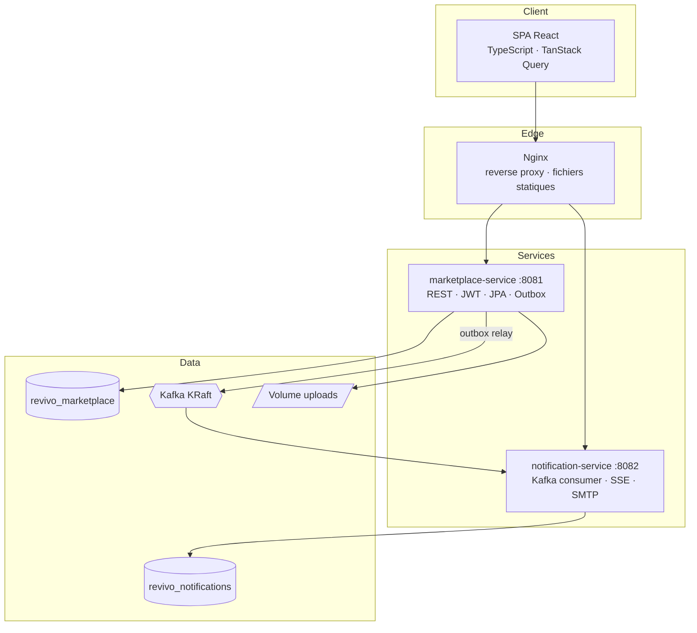
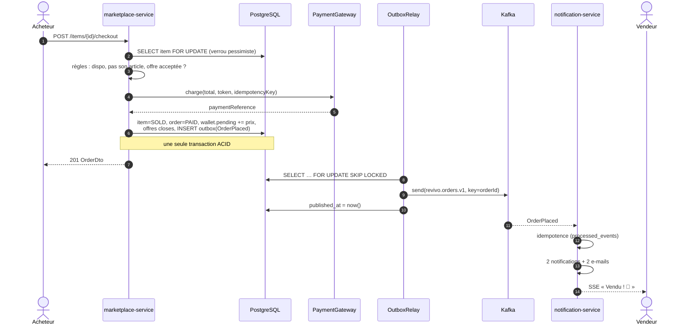
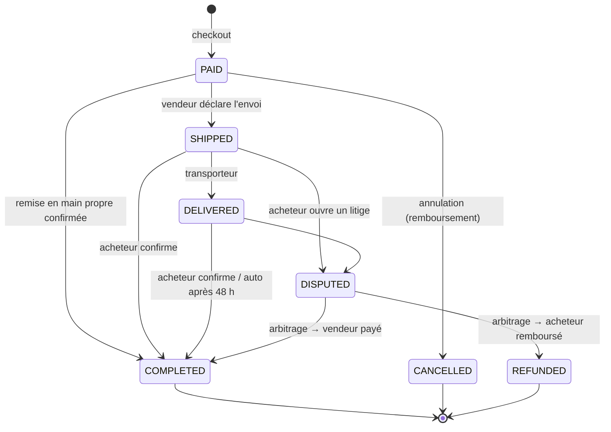
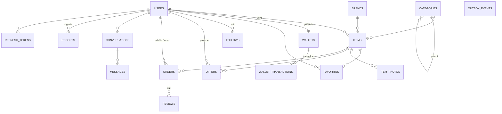

# Architecture

## 1. Vue d'ensemble (C4 — niveau conteneurs)



| Conteneur | Responsabilité | Ne fait pas |
|---|---|---|
| marketplace-service | Toutes les règles métier transactionnelles : comptes, annonces, offres, commandes, porte-monnaie, avis, messagerie, modération | Envoyer des notifications / e-mails |
| notification-service | Transformer les événements métier en notifications in-app (persistées), les pousser en temps réel, envoyer les e-mails | Appeler le marketplace de façon synchrone |
| Kafka | Bus d'événements durable, rejouable, ordonné par agrégat | Porter de la logique |

### Pourquoi ce découpage ?

L'achat d'un article touche à la fois l'annonce, l'offre, la commande et le porte-monnaie. Les répartir sur
des microservices obligerait à écrire un *saga* distribué pour chaque achat. On garde donc ces agrégats
**dans un même service, avec une transaction ACID**, et on externalise ce qui est naturellement asynchrone et
tolérant à la latence : les notifications. Le module `revivo-events` formalise le contrat entre les deux.
Voir [ADR-001](adr/0001-modular-monolith-plus-event-driven-satellite.md).

## 2. Organisation du code (marketplace-service)

*Package-by-feature* : chaque package correspond à un *bounded context* et contient son entité, son repository,
son service applicatif, son contrôleur et ses DTO.

```
user/        Comptes, authentification, abonnements
catalog/     Catégories et marques (référentiels)
item/        Annonces, recherche (Criteria API / Specifications)
favorite/    Favoris
offer/       Négociation
order/       Checkout, cycle de vie, frais, planificateur
wallet/      Séquestre et mouvements
payment/     Port PSP (+ implémentation simulée)
review/      Avis croisés
messaging/   Conversations
moderation/  Signalements, suspensions
admin/       Back-office (KPI, litiges)
outbox/      Publication fiable des événements
```

Principes appliqués :
- **Entités riches** : les invariants vivent dans le domaine (`Item.markSold()`, `Order.transitionTo()`,
  `Wallet.withdraw()`, `Offer.accept()`). Les services orchestrent, ils ne recodent pas les règles.
- **DTO immuables (records)** en entrée et en sortie : les entités JPA ne sont jamais exposées.
- **Validation** à la frontière (Bean Validation) et **erreurs RFC 7807** centralisées (`GlobalExceptionHandler`).
- **Ports et adaptateurs** là où l'infrastructure est amenée à changer : `PaymentGateway`, `StorageService`.
- `open-in-view: false` : pas de lazy loading dans les vues ; les graphes sont chargés explicitement (`@EntityGraph`, `JOIN FETCH`).

## 3. Parcours d'achat



En cas d'exception après le débit (par exemple une contrainte violée), le bloc `catch` **rembourse** le paiement
avant de propager l'erreur : c'est une compensation locale.

## 4. Machine à états des commandes



Les transitions autorisées sont déclarées dans `OrderStatus` et vérifiées par `Order.transitionTo()` :
une transition illégale lève une `BusinessException` (HTTP 409, code `INVALID_ORDER_TRANSITION`).

**Effets financiers** (`WalletService`) :

| Événement | Porte-monnaie vendeur | PSP |
|---|---|---|
| PAID | `pending += prix article` | débit acheteur (total) |
| COMPLETED | `pending -= prix`, `available += prix` | — |
| CANCELLED / REFUNDED | `pending -= prix` | remboursement acheteur (total) |
| Retrait | `available -= montant` | virement (simulé) |

## 5. Modèle de données (marketplace)



Points d'attention :
- montants en `NUMERIC(10,2)` côté base et `BigDecimal` arrondi `HALF_UP` côté Java, jamais de `double` ;
- contraintes d'intégrité en base (unicité des favoris et des avis, `CHECK` sur les soldes ≥ 0, sur la note,
  sur l'ordre des participants d'une conversation) : la base est le dernier rempart ;
- index partiel `outbox_events (created_at) WHERE published_at IS NULL` pour un relais en O(lot).

## 6. Tâches planifiées

| Tâche | Fréquence | Rôle |
|---|---|---|
| `OutboxRelay.relay` | 1 s | Publier les événements en attente |
| `OutboxRelay.purge` | quotidienne | Supprimer les événements publiés depuis plus de 7 jours |
| `OfferService.expireOffers` | 5 min | Expirer les offres en attente / acceptées non utilisées |
| `OrderScheduler.autoComplete` | 10 min | Valider les commandes livrées depuis plus de 48 h et libérer les fonds |

> En multi-instances, `OutboxRelay` est déjà sûr (`SKIP LOCKED`). Pour les autres tâches, ajouter
> ShedLock ou les déplacer dans un worker dédié.
