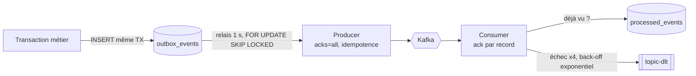

# Catalogue des événements Kafka

## Topics

| Topic | Clé de partition | Événements | Producteur | Consommateurs |
|---|---|---|---|---|
| `revivo.users.v1` | userId | `UserRegistered`, `UserFollowed` | marketplace | notification |
| `revivo.catalog.v1` | itemId | `ItemPublished`, `ItemFavorited`, `ItemPriceDropped` | marketplace | notification |
| `revivo.offers.v1` | itemId | `OfferMade`, `OfferAnswered` | marketplace | notification |
| `revivo.orders.v1` | orderId | `OrderPlaced`, `OrderStatusChanged` | marketplace | notification |
| `revivo.messaging.v1` | conversationId | `MessageSent` | marketplace | notification |
| `revivo.reviews.v1` | targetUserId | `ReviewPosted` | marketplace | notification |
| `<topic>-dlt` | — | messages en échec définitif | notification (error handler) | exploitation |

3 partitions par topic. **L'ordre est garanti par clé**, donc par agrégat : tous les événements d'une même
commande arrivent dans l'ordre.

## Format

Valeur JSON (UTF-8), clé = identifiant de l'agrégat, en-têtes `eventType` et `eventId`.

```json
{
  "type": "OrderPlaced",
  "eventId": "0b8c8e0a-4f1e-4a3c-9a52-0f0e4d6a1c11",
  "occurredAt": "2026-03-01T12:00:00Z",
  "orderId": 42,
  "itemId": 7,
  "itemTitle": "Veste en jean vintage",
  "buyerId": 3,
  "sellerId": 2,
  "itemPrice": 20.00,
  "total": 24.79
}
```

Le champ `type` est le discriminant Jackson (`@JsonTypeInfo(use = NAME)`). Le nom logique est donc découplé
du nom de la classe Java, ce qui permet de renommer ou déplacer une classe sans casser les consommateurs.

## Schémas

| Événement | Champs (en plus de `eventId`, `occurredAt`) |
|---|---|
| `UserRegistered` | userId, username, email |
| `UserFollowed` | followerId, followerUsername, followedId |
| `ItemPublished` | itemId, sellerId, sellerUsername, title, price, followerIds[] |
| `ItemFavorited` | itemId, sellerId, userId, username, title |
| `ItemPriceDropped` | itemId, sellerId, title, oldPrice, newPrice, interestedUserIds[] |
| `OfferMade` | offerId, itemId, itemTitle, buyerId, buyerUsername, sellerId, amount |
| `OfferAnswered` | offerId, itemId, itemTitle, buyerId, sellerId, amount, accepted |
| `OrderPlaced` | orderId, itemId, itemTitle, buyerId, sellerId, itemPrice, total |
| `OrderStatusChanged` | orderId, itemTitle, buyerId, sellerId, previousStatus, newStatus, detail |
| `ReviewPosted` | reviewId, orderId, authorId, authorUsername, targetUserId, rating |
| `MessageSent` | messageId, conversationId, senderId, senderUsername, recipientId, preview |

> **Event-carried state transfer** : les événements portent les données utiles aux consommateurs (titre,
> pseudo, e-mail à l'inscription…). Le notification-service n'a ainsi jamais besoin d'appeler le marketplace.
> `ItemPublished.followerIds` et `ItemPriceDropped.interestedUserIds` font le *fan-out* côté producteur ;
> au-delà de quelques milliers de destinataires, on publierait plutôt un événement par lot.

## Garanties de livraison



| Propriété | Mécanisme |
|---|---|
| Aucun événement perdu | Outbox écrite dans la transaction métier ; publication marquée **après** l'accusé `acks=all` |
| Pas d'événement fantôme | Si la transaction échoue, la ligne outbox disparaît avec elle |
| Ordre par agrégat | Clé de partition + relais qui s'arrête au premier échec d'un lot |
| Doublons inoffensifs | `processed_events(event_id PK)` dans la même transaction que les notifications |
| Messages empoisonnés | JSON invalide → pas de retry, envoi direct en DLT |
| Erreurs transitoires | 4 tentatives, back-off exponentiel (500 ms × 2ⁿ), puis DLT |

## Règles d'évolution du contrat

1. **Ajouter** un champ optionnel : compatible, car les consommateurs ignorent les champs inconnus (`FAIL_ON_UNKNOWN_PROPERTIES=false`).
2. **Ne jamais** renommer, supprimer ou changer le type d'un champ existant.
3. Changement cassant : nouveau type d'événement ou topic `*.v2`, double publication pendant la migration.
4. Un test (`DomainEventSerializationTest`) vérifie l'aller-retour JSON et la tolérance aux champs inconnus.

Étape suivante en production : un **Schema Registry** (Avro ou JSON Schema) avec contrôle de compatibilité en CI.

## Observer les flux en local

- Kafka UI : http://localhost:8090 → topics `revivo.*` → *Messages*
- `GET /api/admin/stats` → `outboxBacklog` (événements en attente de publication)
- Logs : `docker compose logs -f notification-service`
