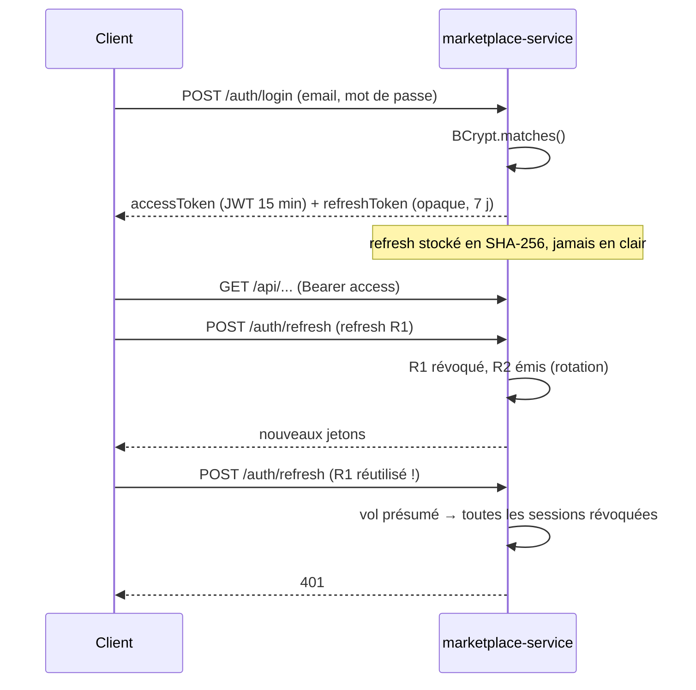

# Sécurité

## Authentification

| Mesure | Implémentation |
|---|---|
| Mots de passe | BCrypt (coût 10), 8 caractères minimum |
| Access token | JWT HS256, 15 min, `iss=revivo`, claims `sub`, `username`, `role` ; vérifié sans accès base |
| Refresh token | 384 bits aléatoires (`SecureRandom`), stocké haché, **usage unique**, détection de réutilisation |
| Révocation | Déconnexion, changement de mot de passe, suspension de compte → révocation de tous les refresh tokens |
| Comptes suspendus | Connexion et refresh refusés ; annonces exclues de la recherche |
| Notification-service | Vérifie les JWT avec le secret partagé ; le flux SSE accepte `?access_token=` (limitation d'`EventSource`) |

## Autorisation

- Règles d'URL dans `SecurityConfig` (public, membre, `ROLE_ADMIN` pour `/api/admin/**`).
- **Contrôle de propriété dans les services** (et non dans les contrôleurs) : modifier une annonce, répondre à une
  offre, expédier une commande, lire une conversation… L'accès est vérifié contre l'identifiant extrait du jeton,
  jamais contre une donnée envoyée par le client.
- Une ressource masquée renvoie 404 aux tiers (pas de fuite d'existence).

## OWASP Top 10 — couverture

| Risque | Mesures |
|---|---|
| A01 Broken Access Control | Contrôles de propriété systématiques, tests dédiés (`onlySellerCanShip`, `onlySellerCanAccept`…) |
| A02 Cryptographic Failures | BCrypt, refresh tokens hachés, IBAN masqué dans l'historique, aucun numéro de carte côté serveur (tokenisation PSP) |
| A03 Injection | JPA / Criteria API paramétrées ; échappement de `%` et `_` dans la recherche `LIKE` |
| A04 Insecure Design | Séquestre, verrou contre la double vente, idempotence du paiement, plancher sur les offres |
| A05 Security Misconfiguration | Pas d'utilisateur Spring par défaut, Actuator limité à `health/info/metrics/prometheus`, secrets externalisés |
| A07 Identification Failures | Rotation et détection de réutilisation des refresh tokens, messages d'erreur génériques au login |
| A08 Data Integrity | Uploads vérifiés par *magic numbers* (pas de confiance dans `Content-Type`), noms de fichiers générés (UUID), URL de photos limitées à `/uploads/` |
| A09 Logging & Monitoring | Logs des événements sensibles (réutilisation de jeton, paiements, arbitrages), métriques Prometheus |

## Durcissement avant une vraie mise en production

- Secret JWT fort (`openssl rand -base64 48`) injecté par un gestionnaire de secrets ; idéalement **RS256/EdDSA**
  avec JWKS, pour que le notification-service ne détienne qu'une clé publique.
- Refresh token en **cookie `HttpOnly; Secure; SameSite=Strict`** plutôt qu'en `localStorage` (choix de démo assumé).
- **Rate limiting** sur `/auth/*`, `/uploads` et la messagerie (Bucket4j ou passerelle API).
- En-têtes de sécurité côté Nginx : CSP, HSTS, `X-Content-Type-Options`, `Referrer-Policy`.
- Vérification d'e-mail et 2FA pour les retraits ; KYC vendeur exigé par le PSP.
- Scan antivirus et réencodage des images (supprime les métadonnées EXIF / GPS).
- Analyse de dépendances en CI (Dependabot / OWASP Dependency-Check) et scan des images (Trivy).
- Kafka : SASL/SCRAM + TLS, ACL par service.
